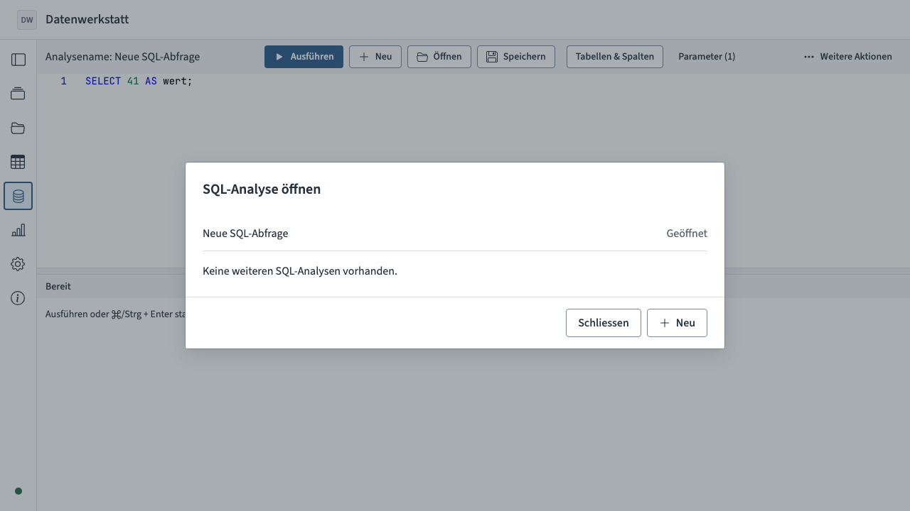
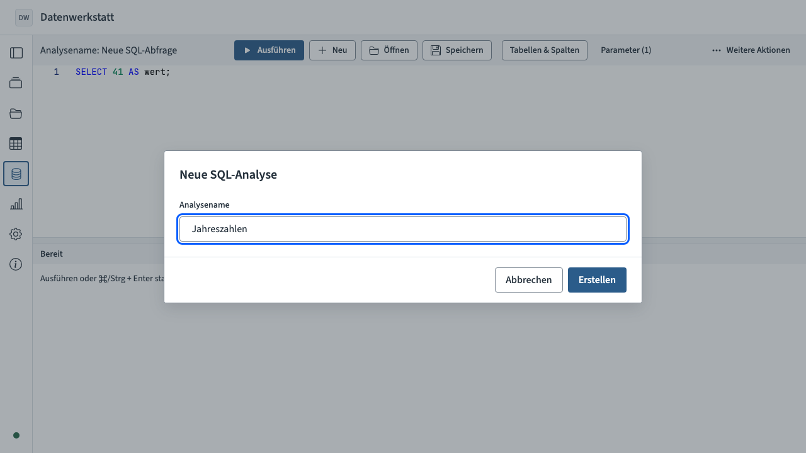
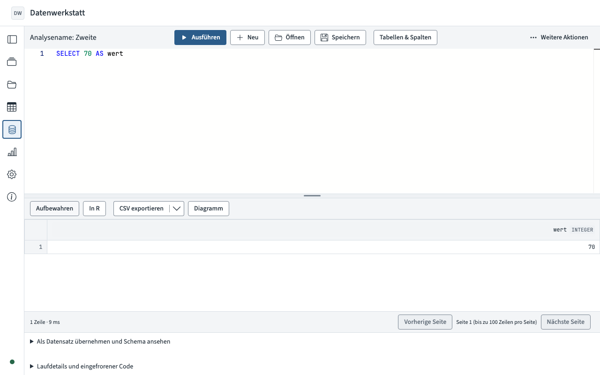

# SQL-Dokumente: Neu und Öffnen — 25. Oktober 2026

Basisrevision `10683d7`, Änderungen im Arbeitsbaum. REQ-019/034/036/062/067/068;
AT-005/007/054/055/058. Der [Dateifingerabdruck](source-sha256.txt) bezeichnet
den geprüften Quellen-/Test-/Dokumentationsstand. Node 22.23.1, npm 11.18.0.

Geliefert: Neu mit vorhandenem Namensdialog, Namensvalidierung/Trim und atomarer
Erstellung eines eigenen SQL-Dokuments; Öffnen statt Laden samt verständlichem
Einzeldokumentzustand und Neu-Aktion. Speichern/Autosave und unabhängige
Editormodelle bleiben erhalten. Der Arbeitsstandshinweis beim Ergebnis entfällt
ohne Ersatz. Projektformat bleibt 3; keine neue Dependency oder Domain-/Speicher-API.

## Tatsächlich ausgeführte Prüfungen

| Befehl | Ergebnis |
| --- | --- |
| `npm run typecheck` | Exit 0 |
| `npm run lint` | Exit 0, einschliesslich Modulgrenzen |
| `npm run build` | Exit 0; bekannte Warnung zu grossen Chunks |
| Untenstehender gezielter Chromium-Aufruf | Exit 0; 5/5 Fälle, 19,2 s |
| `git diff --check` | Exit 0 |

```sh
DW_REUSE_DEV_SERVER=1 npx playwright test tests/e2e/sql-documents.spec.ts tests/e2e/sql-workbench.spec.ts tests/e2e/write-access.spec.ts --grep 'SQL documents: create|SQL documents: save|SQL documents: failed|held retry keeps the SQL reader|SQL exports:' --project=chromium --reporter=list --output=test-results/sql-new-open
```

Der vorhandene Vite-Prozess auf Port 4173 wurde vor Wiederverwendung auf das
aktuelle Repository geprüft. Die Tests starten den Portaltestserver selbst.
[Technische Ausgaben und Chromium-Endausgabe](checks.log).

Die fünf bestandenen Fälle:

1. Neu aus Werkzeugleiste/Öffnen-Dialog, Fokus, Abbrechen/Escape ohne Mutation,
   ungültiger Name ohne Eintrag, getrimmter Name, genau ein unabhängiges Dokument
   mit Starttext/leeren Parametern/Inputs, vorherige Analyse unverändert;
   kein Lauf, Einzeldokumenthinweis, Wiederöffnen und Reload.
2. Speicherfehler erhält SQL-Text für Download und Wiederholung; ungültige Dateien
   erzeugen keinen Eintrag. Autosave/Reload und Filter für archivierte/R-Analysen.
3. Unabhängige SQL-Texte, Parameter, Cursor und Undo beim Öffnen, ohne Lauf;
   nach Bearbeiten/Speichern unverändertes Ergebnis und kein Arbeitsstandshinweis,
   ausgeführter Code weiterhin in Laufdetails. Echte DuckDB-Ausführung, aufbewahrte
   Ergebnisse und Reload. Bestehende Flächenprüfungen bei 1280/1440 px bestanden.
4. Kürzungshinweise und CSV-/XLSX-/Parquet-Exportdialoge bleiben erhalten;
   Abbrechen erzeugt keinen Download und keinen Lauf.
5. Echter zweiter Browser-Tab mit Lesemodus: Neu in Werkzeugleiste und Dialog sowie
   Speichern/Dateiimport gesperrt; Dokumentwechsel und SQL-Download möglich.
   Nach Erwerb des Schreibrechts ist Neu wieder verfügbar.

Die Auswahl deckt die geänderten UI-Pfade und ihre direkten
Speicher-/Ausführungsabhängigkeiten ab. **Nicht ausgeführt:** Unit- oder
vollständige Testsuiten, `npm run verify`, Browser-/Deploymentmatrix, nativer
Safari-Pilot und Benchmarks. Domain, Engine und Archivformat sind unverändert;
deshalb keine erneute vollständige V1-Abnahme. Keine bekannten Blocker im Umfang.

## Visuell geprüft

Die drei tatsächlichen Chromium-Bilder wurden auf Dialogplatzierung,
Werkzeugleistenreihenfolge und Ergebnisdarstellung geprüft.






